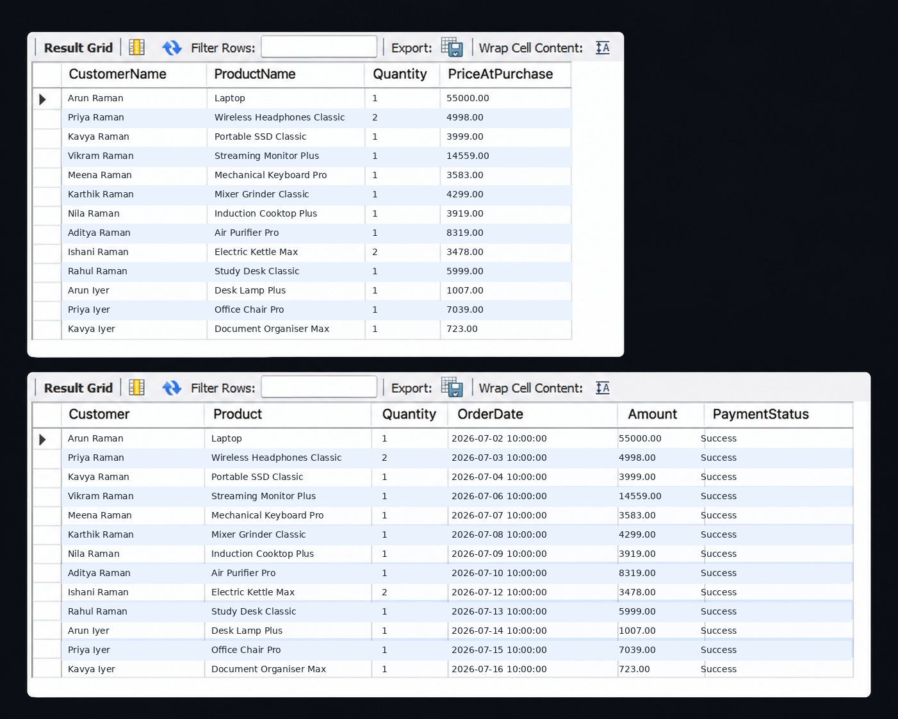

# Week 12 · Transaction Management System

**ShopSphere E-Commerce Database** · Sriramkumar N S · ASML25020

## Aim

Process a laptop purchase as one transaction. A successful UPI payment completes the order and deducts stock. A simulated decline rolls back the temporary order, line item, payment and stock deduction together.

## Setup and SQL files

1. Run [the shared schema](../week15/01-schema.sql) and [01-transactions.sql](01-transactions.sql).
2. Run [the capstone seed](../week15/02-seed-data.sql). It creates customer `1` (Arun Raman), customer `2` (Priya Raman), and laptop SKU `SS-LAP-001` at ₹55,000 with 10 units available.
3. Run [02-demo-and-reports.sql](02-demo-and-reports.sql) to see the successful transaction, the declined transaction and the consistency checks. The [full run order](../WEEKS-12-15.md) places this demo after the capstone reports so the seeded totals are easy to reproduce.

The Week 11 automation uses `Customer`, `Orders`, `OrderItems`, `Product` and `Payment`. This practical keeps those names and tracks stock per seller listing in `Inventory`. Each line records `PriceAtPurchase` so changes to the current product price preserve the original order amount.

## 1. Commit the laptop order

```sql
USE shopsphere_capstone;
CALL PlaceOrder(1, 'SS-LAP-001', 1, 'UPI', TRUE, @paid_order, @no_failure);
```

`PlaceOrder` locks the inventory row and checks availability. It inserts a pending order and its laptop line. The line trigger deducts stock and writes an inventory movement. A successful payment for the full order amount then fires the payment trigger, which marks the order `Completed`. `COMMIT` saves the full purchase.

## 2. Roll back a declined payment

```sql
CALL PlaceOrder(2, 'SS-LAP-001', 1, 'UPI', FALSE, @no_order, @declined_attempt);
```

The procedure inserts a temporary order, deducts the unit and records a simulated failed payment. `ROLLBACK` undoes those changes. A second transaction writes a `CheckoutFailure` audit row so the failed transaction report can show the attempted order ID, payment decline and restored unit. `AttemptedOrderID` is a reference to the cancelled attempt for reporting. The procedure returns the audit ID in `@declined_attempt`.

| Scenario | Order | Payment | Laptop stock on first run |
| --- | --- | --- | --- |
| Successful UPI purchase | `Completed` | `Success` · ₹55,000 | 10 → 9 |
| Simulated UPI decline | Cancelled by rollback | Failed attempt recorded in `CheckoutFailure` | 9 → 8 inside the transaction → 9 after rollback |
| Insufficient inventory | Checkout raises SQLSTATE `45000` | Checkout stops before recording payment | Stock stays at 9 |

`TRUE` and `FALSE` simulate payment decisions for this SQL practical. Run the calls on their own because `PlaceOrder` manages its own transactions. Each successful call purchases another laptop.

## 3. Demonstrate ACID

| Property | ShopSphere demonstration |
| --- | --- |
| Atomicity | The declined purchase rolls back the order, line, payment and stock movement together. The six integrity checks should all return `0`. |
| Consistency | Foreign keys enforce customer and order relationships. `CHECK` prevents negative stock. Successful payment must match the order total and its lines before completion. |
| Isolation | `SELECT ... FOR UPDATE` locks the SKU row during checkout. A second checkout for that SKU waits and checks the latest stock when the lock is released. |
| Durability | After `COMMIT`, reconnect and query the completed order and payment by the order ID from Report 1. A local server restart provides a second demonstration. |

### Two-session isolation demo

Use the alternate laptop listing `SS-LAP-ALT`, which has 15 units in a fresh seed. In connection A, run the first block and leave the transaction open.

```sql
USE shopsphere_capstone;
START TRANSACTION;
SELECT i.InventoryID, i.StockQuantity, p.Price INTO @listing, @available, @price
FROM Inventory i JOIN Product p ON p.ProductID = i.ProductID
WHERE i.SKU = 'SS-LAP-ALT' FOR UPDATE;
```

In connection B, run `CALL shopsphere_capstone.PlaceOrder(2, 'SS-LAP-ALT', 1, 'UPI', TRUE, @order_id, @failure_id);`. While B is waiting, execute this block in connection A to buy all remaining units and commit.

```sql
INSERT INTO Orders (CustomerID, TotalAmount) VALUES (1, @available * @price);
SET @first_order = LAST_INSERT_ID();
INSERT INTO OrderItems (OrderID, InventoryID, Quantity, PriceAtPurchase)
VALUES (@first_order, @listing, @available, @price);
INSERT INTO Payment (OrderID, PaymentMethod, PaymentStatus, AmountPaid)
VALUES (@first_order, 'UPI', 'Success', @available * @price);
COMMIT;
```

Connection B then reports insufficient stock. The alternate SKU has `0` units and connection A has the only checkout that committed in this demonstration. Run this after collecting the baseline analytics because it adds a sale for all remaining units of that listing.

## 4. Reports and evidence

| Report | What to capture in Workbench |
| --- | --- |
| Order transaction | Order ID, Arun Raman, ₹55,000, UPI, `Success`, `Completed` |
| Failed transaction | Priya Raman, attempted order ID, `Failed`, rollback reason and one unit restored |
| Inventory update | Laptop stock before and after the committed order and quantity sold |
| Consistency verification | `CommitCheck = 1`, `RollbackCheck = 1`, and all six violation counts at `0` |

The MySQL 8.0.46 run returned six integrity checks with zero violations. Order `101` and its payment were present after restarting the server. The competing checkout for the alternate SKU waited for the first transaction to commit, then stopped because the SKU had sold out.

```md

```
