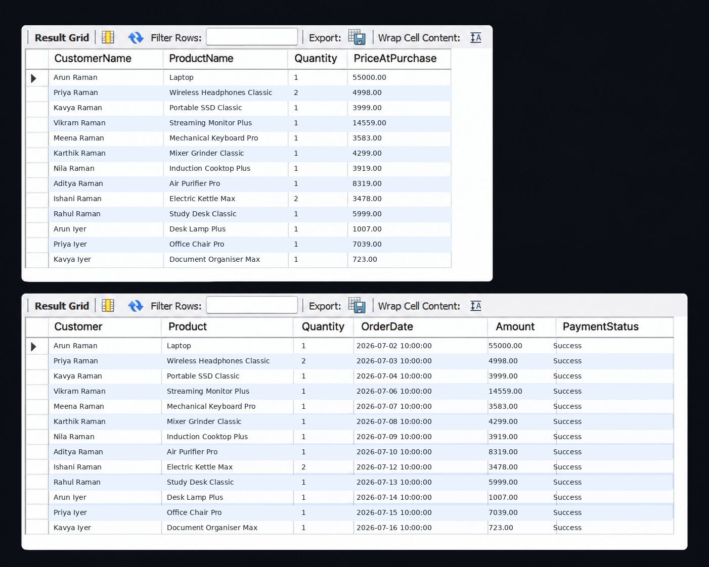

# Week 13 · Database Security and Performance Optimization

**ShopSphere E-Commerce Database** · Sriramkumar N S · ASML25020

## Aim

Give each staff role the access it needs and measure how indexes change ShopSphere’s product, customer and order queries.

## Setup and SQL files

Run the schema, transaction objects and seed from the [shared setup](../WEEKS-12-15.md#run-in-mysql-workbench). Then run the following scripts as the local MySQL DBA:

1. [01-access-control.sql](01-access-control.sql) creates roles, users and reporting views. Save each generated password from the result grids before closing them. MySQL generates a password when the account is first created.
2. [02-indexes-and-performance.sql](02-indexes-and-performance.sql) runs `EXPLAIN ANALYZE` before and after creating the additional indexes. Run it once per fresh schema for a clean comparison.

## 1. Users and access control

| MySQL user | Default role | Allowed actions |
| --- | --- | --- |
| `ss_admin` | `ss_admin_role` | Full schema access, table creation and modification, local user and ShopSphere role management |
| `ss_sales` | `ss_sales_role` | Read orders and sales reports |
| `ss_inventory` | `ss_inventory_role` | View stock and add units through the audited `AddStock` procedure |
| `ss_support` | `ss_support_role` | Read customer contact and order status views |

To show `GRANT` and `REVOKE`, the setup temporarily grants sales `INSERT` on `Payment`, prints the grants, then revokes that permission. The final `SHOW GRANTS ... USING ...` grids form the user access and security reports.

### Test access in separate connections

Create a separate local Workbench connection for each user with its generated password. Run `SELECT CURRENT_USER(), CURRENT_ROLE();` first. Execute test statements individually. A denied query should produce a MySQL access error.

| User | Allowed test | Denied test |
| --- | --- | --- |
| `ss_admin` | `SHOW CREATE TABLE shopsphere_capstone.Orders;` | The admin has full access within the ShopSphere lab schema. |
| `ss_sales` | `SELECT * FROM shopsphere_capstone.v_SalesMonthlyReport;` | `INSERT INTO shopsphere_capstone.Payment (OrderID, PaymentMethod, PaymentStatus, AmountPaid) VALUES (1, 'UPI', 'Success', 1);` |
| `ss_inventory` | `SELECT * FROM shopsphere_capstone.v_InventoryStaffStock;` and `CALL shopsphere_capstone.AddStock('SS-LAP-001', 1);` | `SELECT * FROM shopsphere_capstone.Customer;` |
| `ss_support` | `SELECT * FROM shopsphere_capstone.v_SupportCustomer;` | `SELECT * FROM shopsphere_capstone.Payment;` |

The restock test raises laptop stock by one unit and creates an `InventoryMovement` row with `MovementType = 'Restock'`. Run it after capturing the Week 12 demo if you want the 10 → 9 example in your screenshots. If the transaction setup is reinstalled, rerun the access-control script to regrant `EXECUTE` on the recreated `AddStock` procedure.

## 2. Indexes and query optimization

| Lookup | Index | Purpose |
| --- | --- | --- |
| Product name | `ix_product_name` | Exact name search |
| Category and product name | `ix_product_category_name` | Filter by category and return products in name order |
| Customer email | `uq_customer_email` | Unique email lookup, already created with the schema |
| Customer phone | `ix_customer_phone` | Exact phone lookup |
| Order date | `ix_orders_date` | Date ranges in monthly sales and bestseller queries |
| Customer and order date | `ix_orders_customer_date` | Find one customer’s orders, newest first |

The sales and bestseller queries put a date range on `OrderDate` directly so the engine can use the date index. The top-selling query still groups and ranks qualifying order lines. Inspect `actual time`, `rows`, and `loops` in `EXPLAIN ANALYZE`, or `key` in standard `EXPLAIN`. Performance depends on table size, server load and cache state. The `Before` phase retains the schema’s primary, unique and foreign-key indexes.

## 3. Security answers

- **Why limit access?** A staff account should have the privileges needed for its job. This limits accidental changes and the impact of a compromised login.
- **Why protect payments?** Unrestricted access exposes transaction amounts, methods and statuses and gives unauthorized users opportunities to alter payment records.
- **Why use roles?** A DBA can grant job-based permissions through one role and review or update them centrally when staff responsibilities change.

## 4. Results from MySQL

The product-name lookup went from scanning 100 products to looking up a single match. The category and order-history plans dropped their separate sort steps. The September bestseller query used the date index and took longer in this run while grouping its result, so the report records both timings. The sales, inventory and support permission checks each returned MySQL error `1142` for their denied operation.

```md

```
