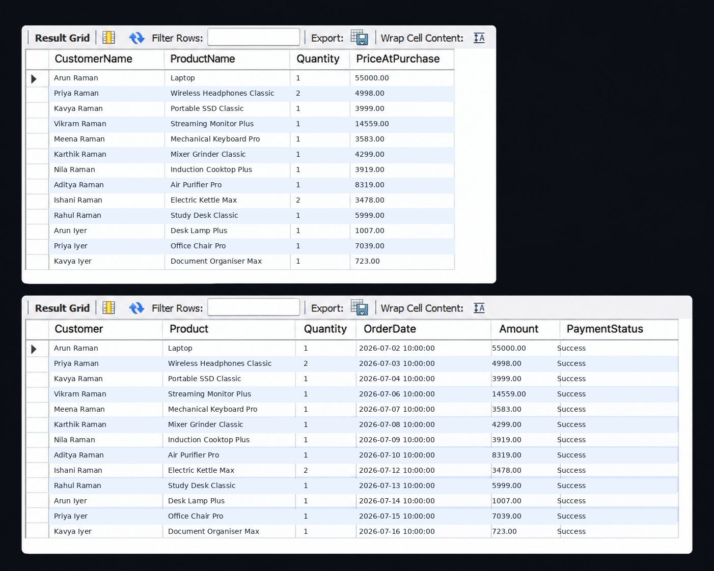

# Week 14 · Business Intelligence and AI Data Preparation

**ShopSphere E-Commerce Database** · Sriramkumar N S · ASML25020

## Aim

Use completed ShopSphere purchases to measure sales, rank products and customers, segment buying behavior and prepare a customer-level dataset for machine learning.

## Setup and SQL files

Run the schema, Week 12 transaction objects and seed from the [shared setup](../WEEKS-12-15.md#run-in-mysql-workbench). Then run [01-analytics.sql](01-analytics.sql) for the BI reports and [02-ai-dataset.sql](02-ai-dataset.sql) for the feature dataset.

## 1. Analytical reports

| Report | Measures |
| --- | --- |
| Sales performance | Total revenue in INR, number of paid orders, average order value and monthly revenue |
| Customer analysis | Total spending, paid orders, average order value, last purchase and spending rank |
| Product performance | Units sold, line revenue, rank, average rating, review count and available stock |
| Time-based features | Purchase year, month, day and orders per purchase date |

The reports use `v_PaidOrders`, which requires both a completed order and a successful payment. Product revenue uses the purchase-time unit price. The product query aggregates sales, reviews and stock separately before joining to the catalog, so multiple reviews or seller listings cannot inflate sales totals.

## 2. Window functions

| Function | ShopSphere use | Behavior on ties |
| --- | --- | --- |
| `RANK()` | Rank products by units sold | Equal unit totals share a rank. The next rank can skip a number. |
| `DENSE_RANK()` | Rank customers by money spent | Equal spending shares a rank. Numbering stays consecutive. |
| `ROW_NUMBER()` | Number each customer’s latest orders and select their preferred category | The timestamp and order ID, or units and category ID, give a deterministic order. |

## 3. Customer segmentation

| Segment | Rule |
| --- | --- |
| Premium | At least 3 paid orders **and** spending of at least ₹25,000 |
| Regular | At least 2 paid orders **or** spending of at least ₹8,000, after the Premium rule |
| Low value | Customers who meet neither rule |

These thresholds are project choices for the sample dataset. The segmentation report shows a customer’s segment, lifetime purchase count and total spending. The summary shows customers, paid orders and revenue per segment.

## 4. AI-ready customer dataset

The snapshot uses the 90 days before `2026-11-01`, with the cutoff day excluded. Open the final result grid in Workbench and use **Export recordset to an external file** to save `shopsphere_customer_features.csv`.

| Output column | Definition and cleaning rule |
| --- | --- |
| `Customer_ID` | One record per customer. Keep as an identifier when preparing model inputs. |
| `Age` | Age at cutoff. Missing ages use the rounded mean of known ages, with 35 as the fallback. |
| `Age_Was_Imputed` | `1` when the age was filled in. |
| `Total_Purchases` | Paid orders in the 90-day window. Customers with zero purchases receive `0`. |
| `Total_Spending` | Sum of the customer’s paid orders in INR, or `0`. |
| `Average_Order_Value` | Average paid order amount in INR, or `0`. |
| `Purchase_Frequency` | Paid orders per 30-day period, calculated as `Total_Purchases / 3`. |
| `Preferred_Category_ID` | Category with the highest unit count. Smaller ID wins a tie. `0` means no purchase history in the window. |
| `Pref_*` | One-hot category flags for Electronics, Home and Kitchen, Office and Study, Sports and Travel, Apparel, and None. |

Every order contributes once to the customer-level count and spend. Category features aggregate order items separately; `ROW_NUMBER()` selects one category per customer before joining. The final grid excludes contact fields and produces **50 rows** on the seed dataset.

## 5. Result output

[Download the 50-row customer feature dataset](customer-features.csv). The seed run returned 50 distinct customer IDs, eight imputed ages and exactly one active preferred-category flag per customer.

```md

```
