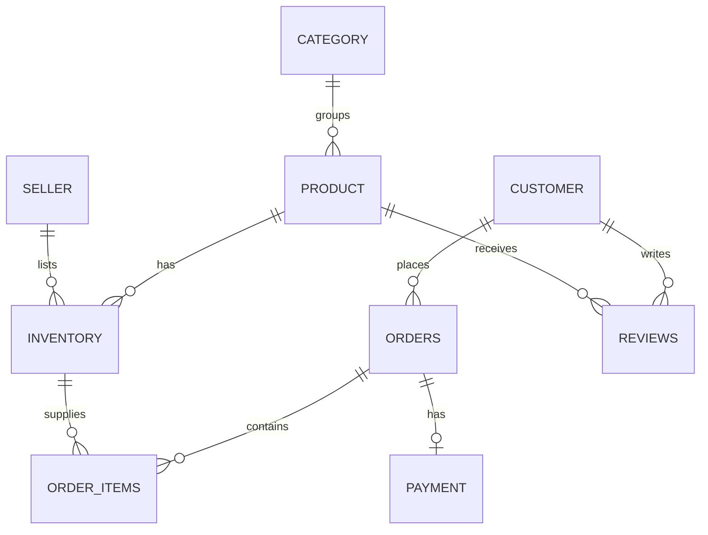
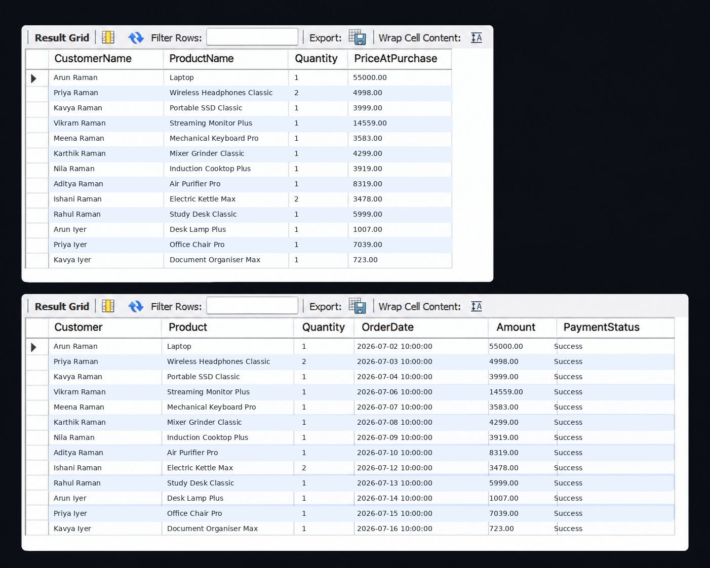

# Week 15 · ShopSphere E-Commerce Intelligence Platform

**Student** Sriramkumar N S · **Register number** ASML25020 · **Database** `shopsphere_capstone` · **Engine** MySQL 8.0.18+

## 1. Problem and requirements

ShopSphere needs one database for customers, products, categories, sellers, stock, orders, payments and reviews. Staff need to complete checkout without overselling and to track stock changes. The business needs reliable reports on sales, customer behavior, inventory and product feedback.

The original ShopSphere design supplies the project domain. The order-management and automation modules supply the core table names and purchase-price history. The inventory module supplies the seller-specific SKU and reorder-level design. This capstone combines those ideas in its own MySQL schema. The [earlier ShopSphere design](https://github.com/sailin0037/dbms-dommy-/tree/main/week3) is in the original repository.

## 2. Files and execution

Follow the [full run order](../WEEKS-12-15.md#run-in-mysql-workbench). The schema is installed first, then the Week 12 triggers and procedures, then the seed. Install the Week 13 indexes and Week 14 analytics before running the final capstone scripts.

| File | Contents |
| --- | --- |
| [01-schema.sql](01-schema.sql) | Tables, keys, constraints, relationships and stock audit structures |
| [02-seed-data.sql](02-seed-data.sql) | Fictional customers, sellers, catalog, inventory, historical orders, successful payments and verified-purchase reviews |
| [03-capstone-objects.sql](03-capstone-objects.sql) | History, sales and product views, two functions and a date-range sales procedure |
| [04-queries-and-reports.sql](04-queries-and-reports.sql) | Basic to advanced query examples and the four business intelligence reports |
| [Week 12 transactions](../week12/01-transactions.sql) | Checkout and restock routines, stock and payment triggers and the inventory movement ledger |
| [Week 13 indexes](../week13/02-indexes-and-performance.sql) | Product, customer and order indexes with before/after execution plans |
| [Week 14 analytics](../week14/01-analytics.sql) | Paid-order feature aggregation, product and customer ranking and customer segmentation |

## 3. Final ER diagram



The diagram shows the business tables. `InventoryMovement` and `CheckoutFailure` store audit data. The SQL table names `OrderItems` and `Reviews` correspond to `ORDER_ITEMS` and `REVIEWS` in the diagram.

| Table | Primary key | Foreign keys | Main attributes and rules |
| --- | --- | --- | --- |
| `Customer` | `CustomerID` | — | Name, unique email, phone, city and optional birth date |
| `Category` | `CategoryID` | — | Unique category name |
| `Product` | `ProductID` | `CategoryID` | Product name and current price |
| `Seller` | `SellerID` | — | Unique store name and contact email, city |
| `Inventory` | `InventoryID` | `ProductID`, `SellerID` | Unique SKU and product–seller pair, available stock, reorder level |
| `Orders` | `OrderID` | `CustomerID` | Order date, total amount, status |
| `OrderItems` | `OrderItemID` | `OrderID`, `InventoryID` | Quantity, purchase-time price, unique order–listing pair |
| `Payment` | `PaymentID` | Unique `OrderID` | Payment method, status, date and amount |
| `Reviews` | `ReviewID` | `ProductID`, `CustomerID` | Rating from 1 to 5, review text and date, one review per customer and product |
| `InventoryMovement` | `MovementID` | `InventoryID`, optional `OrderID` | Sales and restocks with before/after quantities and timestamp |
| `CheckoutFailure` | `FailureID` | `CustomerID`, `InventoryID` | Attempted order number, method, requested quantity, restored stock and reason |

### Normalization

- **1NF.** Each column has a single value. A multi-product order uses multiple `OrderItems` rows. Each review is one row.
- **2NF.** Quantity and purchase-time price describe an entire order–listing pair. Product and seller attributes live in their own tables. A product can have multiple seller listings, with one listing per product–seller pair.
- **3NF.** Category names stay with categories, contact details stay with customers or sellers, and order lines find products through inventory. `TotalAmount` is a stored financial total for checkout and reporting. The payment trigger checks it against the line total and charged amount before marking the order complete.

## 4. Seed dataset

| Table | Minimum required | Seeded rows |
| --- | ---: | ---: |
| `Customer` | 50 | 50 |
| `Product` | 100 | 100 |
| `Seller` | 20 | 20 |
| `Orders` | 100 | 100 |
| `Payment` | 100 | 100 |
| `Reviews` | 50 | 50 |
| `Inventory` | — | 103 |
| `OrderItems` | — | 133 |

The dataset covers July through October 2026 and uses INR prices. Three products have alternate seller listings. Some birth dates are missing so Week 14 can demonstrate imputation. The review seed selects buyers from their completed order lines and keeps one review per buyer and product.

## 5. SQL and automation

| Object | What it demonstrates |
| --- | --- |
| `v_CustomerOrderHistory` | Customer, order, amount and payment status in one view |
| `v_SalesReport` | Monthly paid orders, revenue and average order value |
| `v_ProductPerformance` | Sales, review and stock measures at product level |
| `PlaceOrder`, `AddStock` | Transactional checkout and logged stock replenishment |
| `Generate_Sales_Report` | Paid orders, revenue and average order value for an inclusive date range |
| `Customer_Total_Spending`, `Product_Revenue` | Lifetime paid spend by customer and line revenue by product |
| `trg_orderitem_stock` | Locks stock, checks quantity, deducts units and records the movement |
| `trg_payment_complete` | Matches the successful payment to the order and lines, then completes the order |
| `trg_order_cancellation` | Blocks cancellation after a stock deduction or a successful payment. The failed-checkout workflow uses rollback. |

The checkout procedure takes one SKU per call. The schema, triggers and sample orders demonstrate multi-line orders. The lab simulates payment decisions in SQL.

## 6. Business intelligence report

[04-queries-and-reports.sql](04-queries-and-reports.sql) generates these four reports. Run it before the Week 12 purchase demo for the seeded baseline.

| Report | What it covers |
| --- | --- |
| Sales | Total revenue, monthly trend, bestsellers and category revenue |
| Customers | Spending rank, purchase frequency and premium, regular and low-value segments |
| Inventory | Low-stock SKUs at or below their reorder level, fast movers with 8+ units sold, and overstock with 100+ units on hand |
| Products | Top-rated products with review counts, slow sellers with at most one unit sold, and monthly customer feedback |

### Findings and next actions

- ShopSphere made **₹7,88,372** across **100 paid orders**. August led with **₹2,69,477**. Electronics contributed **₹5,46,176**, so track whether future monthly totals depend on a small number of high-priced electronics orders.
- Wireless Headphones Classic led unit sales with **26 units**. The four Premium customers generated **₹2,65,126**. Use the segmentation report to distinguish repeat high-value buyers from customers who made one large purchase.
- Five SKUs were at or below their reorder level, and five carried **125 units** each. Compare recent sell-through with each alert before reordering or discounting.
- August had **10 low ratings out of 20 reviews**. Review the comments alongside the rating counts before drawing product-level conclusions from the small samples.

```md

```

## 7. Presentation and demonstration

| Slide | Show | Run or explain |
| --- | --- | --- |
| 1 | Business problem | Catalog, seller stock, checkout and business reporting in one schema |
| 2 | ER diagram | Follow an order from customer to order items, seller SKU and payment |
| 3 | Schema and data | Show the keys, normalization and row counts from the final seed grid |
| 4 | Transaction demo | Commit the UPI laptop purchase and show how a payment decline rolls back |
| 5 | Roles and indexes | Show a permitted sales report, the denied payment insert and the product lookup plans |
| 6 | Analytics | Show revenue, bestsellers, stock flags, segmentation and the AI feature grid |

```sql
USE shopsphere_capstone;
CALL Generate_Sales_Report('2026-07-01', '2026-10-31');
SELECT Customer_Total_Spending(1) AS ArunLifetimeSpend,
       Product_Revenue(5) AS HeadphoneRevenue;
EXPLAIN SELECT ProductID, Name, Price FROM Product WHERE Name = 'Laptop';
```
